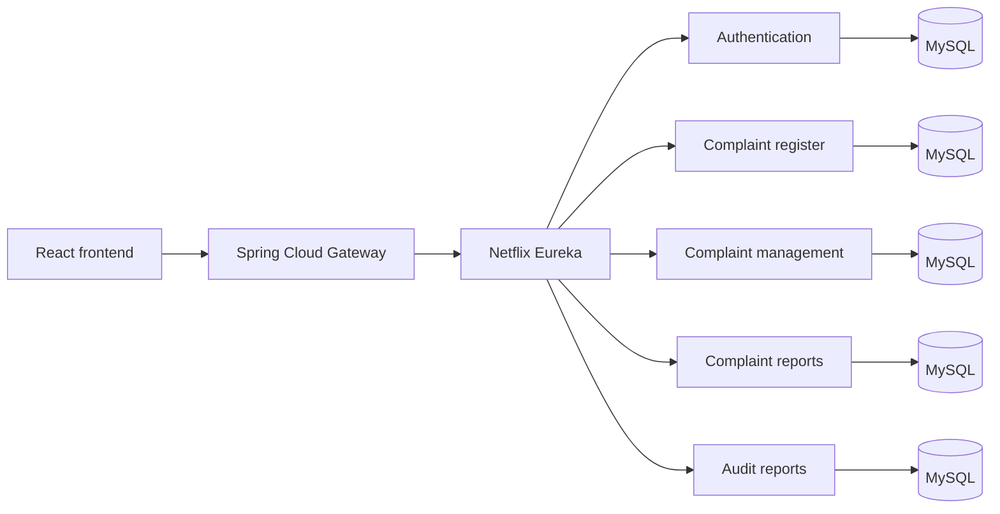

# PDAU Microservices

Technical documentation for the microservices-based evolution of the **Plataforma de Denuncias Anónimas Universitarias (PDAU)**.

## What is PDAU?

PDAU is a university platform for submitting, tracking, managing, and analyzing anonymous complaints. It gives members of the university community a channel to report situations without exposing their identity, while giving authorized administrators the tools needed to review cases, communicate responses, manage appeals, archive records, and inspect operational and audit information.

The original application was developed as a monolith. This version separates the main capabilities into independent Spring Boot services so that each business area can evolve, deploy, and scale without coupling all functionality to one application.

## Purpose and usefulness

The platform addresses the difficulty of receiving and following up on sensitive complaints through informal or non-traceable channels. Its main value is to:

- provide an anonymous and structured reporting channel;
- generate a tracking token so the complainant can consult progress without creating an account;
- centralize evidence, responses, comments, appeals, and state changes;
- provide administrators with statistics for decision-making;
- preserve an auditable history of actions taken during case management;
- isolate data and responsibilities by service, improving maintainability and evolution.

This repository is intentionally documentary: each implementation remains in its own source repository. It provides a single architectural view, explains the request flow, and links directly to the detailed reference for every service.

## Architecture at a glance



The platform separates complaint intake, identity and access, operational management, reporting, and audit history. Each business service owns its data store, while Eureka provides service discovery and the gateway is the public entry point.

## General installation

The source code is distributed across the repositories listed below. A complete local environment requires Java 21, Maven, MySQL, RabbitMQ, and a running Eureka server. Node.js and npm are additionally required for the React frontend.

### 1. Clone the repositories

```bash
mkdir pdau-platform
cd pdau-platform

git clone https://github.com/BSebastianGonzalez/pdau-service_discovery.git
git clone https://github.com/BSebastianGonzalez/pdau-api_gateway.git
git clone https://github.com/BSebastianGonzalez/pdau_authentication.git
git clone https://github.com/BSebastianGonzalez/pdau_complaint_register.git
git clone https://github.com/BSebastianGonzalez/pdau-complaint_management.git
git clone https://github.com/BSebastianGonzalez/pdau_complaint_reports.git
git clone https://github.com/BSebastianGonzalez/pdau_audit_reports.git
git clone https://github.com/BSebastianGonzalez/pdau_frontend.git
```

### 2. Prepare infrastructure

Create separate MySQL databases for the business services. Each service uses its own `DB_URL`, `DB_USER`, and `DB_PASSWORD`. Start RabbitMQ with TLS enabled when using the current production-oriented broker configuration.

The services also require these shared settings:

| Variable | Used by | Purpose |
|---|---|---|
| `SERVICE_DISCOVERY` | Eureka clients | Eureka server URL, normally `http://localhost:8761/eureka/` |
| `DB_URL`, `DB_USER`, `DB_PASSWORD` | Business services | Service-owned MySQL connection |
| `RABBITMQ_URL` | Complaint, management, reports, audit | RabbitMQ connection |
| `SENDGRID_API_KEY`, `EMAIL` or service email settings | Authentication and management | Email delivery |
| `CLOUDINARY_NAME`, `CLOUDINARY_KEY`, `CLOUDINARY_SECRET` | Services handling files | Evidence and response file storage |
| `REGISTRO_DENUNCIAS_URL`, `AUTHENTICATION_URL` | Complaint management | Synchronous service-to-service calls |

Use the exact variable names and application configuration from each source repository. Never commit credentials or tokens.

### 3. Start services in dependency order

Run each Java service from its repository with Maven:

```bash
./mvnw spring-boot:run
```

On Windows, use `mvnw.cmd spring-boot:run`. Start them in this order:

1. Service Discovery (`8761`)
2. API Gateway (`8000`)
3. Authentication (`8081`)
4. Complaint Register (`8080`)
5. Complaint Management (`3000`)
6. Complaint Reports (`8000`, override this port when running with the gateway)
7. Audit Reports (`3001`)

The gateway and complaint reports currently declare the same default port. They must not bind to the same host port; configure one of them with an alternative port for a local all-in-one deployment.

### 4. Start the frontend

The frontend is maintained in its own repository:

```bash
cd pdau_frontend/pdau
npm install
npm run dev
```

Configure its API base URL to point to the gateway. The detailed setup and available environment variables belong to the frontend source repository.

### 5. Service-specific setup

The general process above establishes the platform order, but each service has independent configuration, dependencies, and runtime behavior. The following documents contain the installation variables, classes, endpoints, and execution flow for each individual service:

- [API Gateway](docs/services/api-gateway.md)
- [Service Discovery](docs/services/service-discovery.md)
- [Authentication](docs/services/authentication.md)
- [Complaint Register](docs/services/complaint-register.md)
- [Complaint Management](docs/services/complaint-management.md)
- [Complaint Reports](docs/services/complaint-reports.md)
- [Audit Reports](docs/services/audit-reports.md)

## System flow and service documentation

The documents below follow the logical flow of the platform:

1. [Frontend reference](docs/frontend.md) — user and administrator interface.
2. [API Gateway](docs/services/api-gateway.md) — public entry point and routing layer.
3. [Service Discovery](docs/services/service-discovery.md) — Eureka registry used by the services.
4. [Authentication](docs/services/authentication.md) — login, password recovery, administrator profiles, and documents.
5. [Complaint Register](docs/services/complaint-register.md) — anonymous complaint intake, categories, states, and evidence.
6. [Complaint Management](docs/services/complaint-management.md) — responses, comments, appeals, archiving, and indicators.
7. [Complaint Reports](docs/services/complaint-reports.md) — operational complaint statistics.
8. [Audit Reports](docs/services/audit-reports.md) — administrator activity and historical audit queries.

## Communication model

- **Synchronous HTTP:** the frontend calls the gateway, which discovers services through Eureka.
- **Asynchronous events:** complaint-related services use RabbitMQ for decoupled notifications and cross-service events.
- **Independent persistence:** each business service is configured with its own MySQL database.
- **External integrations:** authentication and management use email delivery; complaint management and registration support Cloudinary-backed files where configured.

## Source repositories

| Component | Source repository |
|---|---|
| Authentication | [pdau_authentication](https://github.com/BSebastianGonzalez/pdau_authentication) |
| Complaint register | [pdau_complaint_register](https://github.com/BSebastianGonzalez/pdau_complaint_register) |
| Complaint management | [pdau-complaint_management](https://github.com/BSebastianGonzalez/pdau-complaint_management) |
| Complaint reports | [pdau_complaint_reports](https://github.com/BSebastianGonzalez/pdau_complaint_reports) |
| Audit reports | [pdau_audit_reports](https://github.com/BSebastianGonzalez/pdau_audit_reports) |
| API Gateway | [pdau-api_gateway](https://github.com/BSebastianGonzalez/pdau-api_gateway) |
| Service Discovery | [pdau-service_discovery](https://github.com/BSebastianGonzalez/pdau-service_discovery) |
| Frontend reference | [pdau_frontend](https://github.com/BSebastianGonzalez/pdau_frontend) |

## Technology baseline

- Java 21 and Spring Boot 3.x
- Spring Web, Spring Data JPA, and MySQL
- Spring Cloud Gateway
- Netflix Eureka
- RabbitMQ
- React and Vite frontend
- JWT/Spring Security in the authentication service
- Docker support in the Java services

## Configuration and security

The source repositories use environment variables for database credentials, Eureka location, RabbitMQ, email providers, Cloudinary, and service-to-service URLs. Secrets must never be committed. Production deployments should additionally restrict gateway exposure, secure RabbitMQ and Eureka traffic, validate JWT configuration, and apply least-privilege database credentials.

## Scope

This repository is an architectural index and portfolio document. It does not replace the individual source repositories, their build instructions, or deployment configuration.
