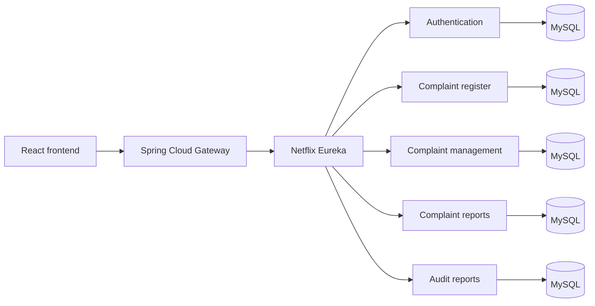

# PDAU Microservices

Technical documentation for the microservices-based evolution of the **Plataforma de Denuncias Anónimas Universitarias (PDAU)**.

This repository is intentionally documentary: each implementation remains in its own source repository. It provides a single architectural view, explains the request flow, and links directly to the detailed reference for every service.

## Architecture at a glance

The platform separates complaint intake, identity and access, operational management, reporting, and audit history. Each business service owns its data store, while Eureka provides service discovery and the gateway is the public entry point.

## System flow and service documentation

The documents below follow the logical flow of the platform:

1. [Frontend reference](docs/frontend.md) — user and administrator interface.
2. [API Gateway](docs/services/api-gateway.md) — public entry point and routing layer.
3. [Service Discovery](docs/services/service-discovery.md) — Eureka registry used by the services.
4. [Authentication](docs/services/authentication.md) — login, password recovery, administrator profiles, and documents.
5. [Complaint Register](docs/services/complaint-register.md) — anonymous complaint intake, categories, states, and evidence.
6. [Complaint Management](docs/services/complaint-management.md) — responses, comments, appeals, archiving, and indicators.
7. [Complaint Reports](docs/services/complaint-reports.md) — operational complaint statistics.
8. [Audit Reports](docs/services/audit-reports.md) — administrator activity and historical audit queries.

## Communication model

- **Synchronous HTTP:** the frontend calls the gateway, which discovers services through Eureka.
- **Asynchronous events:** complaint-related services use RabbitMQ for decoupled notifications and cross-service events.
- **Independent persistence:** each business service is configured with its own MySQL database.
- **External integrations:** authentication and management use email delivery; complaint management and registration support Cloudinary-backed files where configured.

## Source repositories

| Component | Source repository |
|---|---|
| Authentication | [pdau_authentication](https://github.com/BSebastianGonzalez/pdau_authentication) |
| Complaint register | [pdau_complaint_register](https://github.com/BSebastianGonzalez/pdau_complaint_register) |
| Complaint management | [pdau-complaint_management](https://github.com/BSebastianGonzalez/pdau-complaint_management) |
| Complaint reports | [pdau_complaint_reports](https://github.com/BSebastianGonzalez/pdau_complaint_reports) |
| Audit reports | [pdau_audit_reports](https://github.com/BSebastianGonzalez/pdau_audit_reports) |
| API Gateway | [pdau-api_gateway](https://github.com/BSebastianGonzalez/pdau-api_gateway) |
| Service Discovery | [pdau-service_discovery](https://github.com/BSebastianGonzalez/pdau-service_discovery) |
| Frontend reference | [pdau_frontend](https://github.com/BSebastianGonzalez/pdau_frontend) |

## Technology baseline

- Java 21 and Spring Boot 3.x
- Spring Web, Spring Data JPA, and MySQL
- Spring Cloud Gateway
- Netflix Eureka
- RabbitMQ
- React and Vite frontend
- JWT/Spring Security in the authentication service
- Docker support in the Java services

## Configuration and security

The source repositories use environment variables for database credentials, Eureka location, RabbitMQ, email providers, Cloudinary, and service-to-service URLs. Secrets must never be committed. Production deployments should additionally restrict gateway exposure, secure RabbitMQ and Eureka traffic, validate JWT configuration, and apply least-privilege database credentials.

## Scope

This repository is an architectural index and portfolio document. It does not replace the individual source repositories, their build instructions, or deployment configuration.
