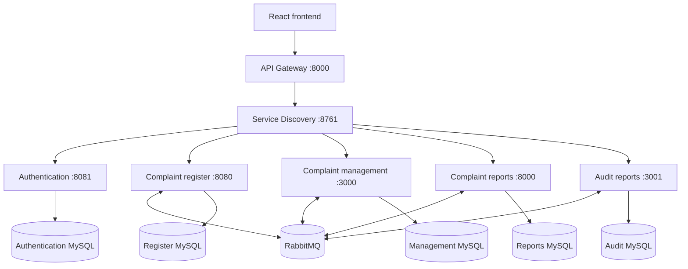
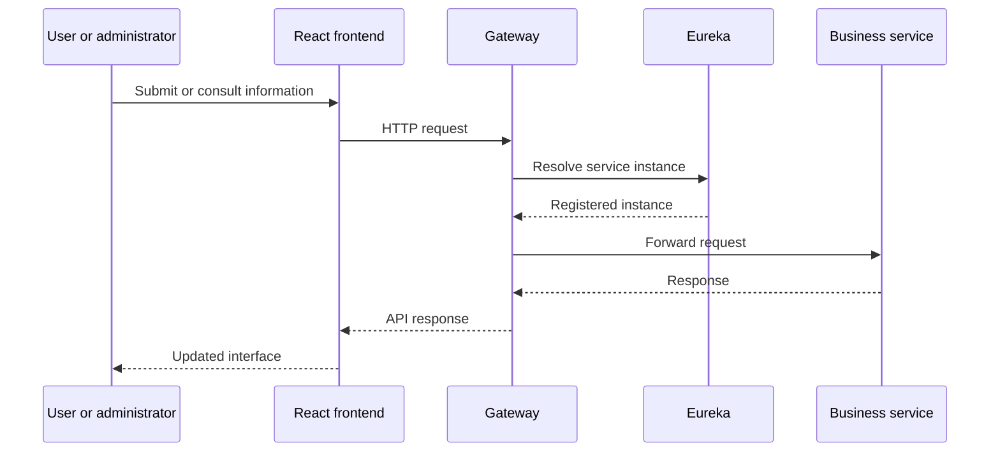

# PDAU architecture

## Components

Ports are the defaults declared by the current source repositories. The gateway and complaint reports both declare port `8000`; deployments should override one of them or place them behind distinct runtime instances.

## Request flow

## Responsibilities

| Layer | Responsibility |
|---|---|
| Frontend | User and administrator workflows, forms, evidence upload, consultation, indicators, and audit views |
| Gateway | Single public HTTP entry point and discovery-based routing |
| Discovery | Registration and lookup of service instances |
| Authentication | Identity, login, password recovery, roles, administrator profiles, and documents |
| Complaint register | Anonymous complaint creation, categories, states, and evidence |
| Complaint management | Responses, comments, appeals, archiving, and management indicators |
| Complaint reports | Aggregated complaint statistics by total, state, category, and date |
| Audit reports | Administrator activity totals and historical activity breakdowns |

## Data ownership

The business services are designed around database-per-service ownership. This reduces direct coupling between schemas and allows each service to evolve independently. Cross-service communication should use APIs or events rather than direct database access.

## Operational considerations

- Eureka must be available before clients can register and discover instances.
- Gateway routes must match the service IDs registered in Eureka.
- RabbitMQ connectivity is required by the complaint-related services that publish or consume events.
- Environment variables must be supplied per deployment; repository configuration files contain placeholders rather than production credentials.
- The default ports are development-oriented and may need external mapping in a deployed environment.
